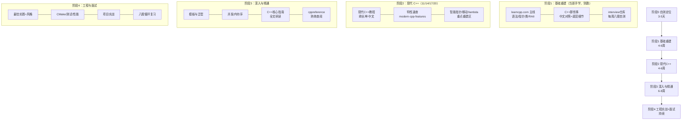

# C++ 复习与精通路线图（遗忘重启版）

> 预计总时长：**4~6 个月**（在职业余，每天 1.5~2 小时；全职可压缩到 2~3 个月）
> 定位：你学过 C++ 但忘了大半，目标是**系统性重建 → 现代 C++ → 精通底层与工程**。
> 与 Rust 学习的配合：见文末「C++ / Rust 双线作战策略」。

## 一、总览路线图

## 二、分阶段详细计划

### 阶段 0：自测定位（3~5 天）

先搞清楚自己忘了多少，决定从哪里开始，避免在会的地方浪费时间：

- [ ] 把 `books/04-C++面试知识-interview/` 的 C++ 目录快速过一遍（虚函数、内存布局、STL、关键字），标记「完全忘了 / 模糊 / 还记得」三类
- [ ] 直接做 20 道 leetcode 简单题（C++），暴露语法生疏度
- **判断标准**：如果"指针/引用/类的基本概念"都模糊 → 从阶段 1 第 1 周开始；如果只是模板/STL/新标准忘了 → 直接从阶段 1 后半 + 阶段 2 开始

### 阶段 1：基础重建（4~6 周）——把自己当新手，不要跳

**主线**：[learncpp.com](https://www.learncpp.com/)（全世界最好的免费 C++ 教程，有quiz）
**中文对照**：`books/03-C++那些事-CPlusPlusThings/`（基础篇）
**自测**：每周末用 `books/04-C++面试知识-interview/` 对应主题的八股题检验

| 周 | 内容 | learncpp 对应 | 关键检查点 |
| --- | --- | --- | --- |
| 1 | 变量/类型/运算符/流 IO、函数 | Ch.1-8 | 能不看书写出完整小程序 |
| 2 | **指针 / 引用 / const** ⭐ | Ch.9-12 | 能讲清指针 vs 引用、const 正确性 |
| 3 | 类：构造/析构/拷贝控制/运算符重载 | Ch.13-14 | **RAII 思想**（这是后面 Rust 所有权的基础！） |
| 4 | 继承/虚函数/多态/抽象类 ⭐ | Ch.15-20 | 虚表机制、对象切片、为什么有虚析构 |
| 5 | 模板入门、异常、移动语义初识 | Ch.21-22 | 右值引用、`std::move` 干了什么 |
| 6 | STL：vector/string/map/算法/迭代器 | Ch.23-26 | 迭代器失效规则、常用算法 |

> ⭐ 你之前忘掉的高频区大概率在这几周里。规则：**每个概念都要写代码验证**，用 [Compiler Explorer](https://godbolt.org/) 看汇编/输出是找回手感的最快方式。

### 阶段 2：现代 C++（4~6 周）——拉开差距的部分

**主线**：`books/02-现代C++教程-modern-cpp-tutorial/`（欧长坤著，中文，覆盖 C++11/14/17/20，在线版 [changkun.de/modern-cpp](https://changkun.de/modern-cpp/)）
**速查**：`books/05-现代C++特性速查-modern-cpp-features/`（每个新特性一页纸带示例）

| 周 | 内容 | 要点 |
| --- | --- | --- |
| 7 | C++11 语言核心：auto/decltype/范围for/nullptr/枚举类/constexpr | 现代代码的地基 |
| 8 | **移动语义与完美转发** ⭐、**智能指针**（unique/shared/weak）⭐ | 现代内存管理核心，面试必考，也是 Rust 对照重点 |
| 9 | lambda、std::function/bind、可调用对象 | 现代 STL 用法的前提 |
| 10 | 容器进阶与算法、STL 实践 | `std::optional`/`variant`/`any`/`string_view`/`span` |
| 11 | 并发基础：thread/mutex/condition_variable/atomic 入门 | 先会用，深入放阶段 3 |
| 12 | C++17/20 概览：结构化绑定/if constexpr/Ranges/Concepts/协程概念 | 知道有什么、什么场景用，不必立刻精通 |

### 阶段 3：深入与精通（6~8 周）——从"会写"到"懂原理"

| 周 | 内容 | 资料 |
| --- | --- | --- |
| 13-14 | **模板与泛型进阶**：SFINAE、模板元编程思想、C++20 Concepts 实战 | 教程 + cppreference |
| 15-16 | **并发深入**：内存模型、memory_order、false sharing、无锁入门 | cppreference atomic 页 + 付费书《C++ Concurrency in Action》 |
| 17-18 | **内存与对象模型**：虚表/虚继承内存布局、对齐、new/delete 重载、allocator | C++那些事底层篇 |
| 19-20 | **C++ 核心指南全文研读** ⭐：`books/01-C++核心指南-CppCoreGuidelines/`（Stroustrup & Sutter 官方，中英都有，先读 FAQ+主要章节） | 精通的标志是知道"为什么这样写" |

**阶段 3 检查点**：能解释清楚——虚函数调用全过程、`std::move` 不移动任何东西、为什么 `atomic` 的 `relaxed` 和 `seq_cst` 都存在、模板实例化发生在何时。

### 阶段 4：工程实战 + 面试准备（持续）

- **规范**：`books/06-C++最佳实践-cppbestpractices/`（Jason Turner，短小精悍）+ `books/08-Google风格指南-styleguide/`
- **工程能力**：CMake（现代用法）、单元测试（GoogleTest/Catch2）、性能分析（perf/VTune）、Sanitizers（ASan/UBSan/TSan——重点，比 IDE 调试更能暴露问题）
- **项目实战**（挑 1~2 个）：
  1. 用现代 C++ 重写一个你以前的旧项目（禁用裸 new/delete，全部智能指针 + RAII）
  2. 写一个小的组件：线程池 / LRU 缓存 / 简单 JSON 解析器（面试高频手写题，一举两得）
  3. 与 Rust 目录联动：同一项目 C++ / Rust 各写一遍，对比体会（两边简历都能写）
- **面试**：`books/04-C++面试知识-interview/` 每周循环过一遍；LeetCode 用 C++ 刷 150+ 题

## 三、遗忘重启的学习原则

1. **把自己当新手**：忘掉的东西直接当没学过，从 learncpp 第 1 章过，别觉得丢人——基础重建 4~6 周比你想象的值得
2. **每个概念必写代码**：C++ 的坑不在概念在细节（未定义行为、隐式转换、迭代器失效），只有跑过才真记得
3. **两本书不要并行读**：同一主题 learncpp（英文细讲）+ C++那些事（中文速览）是"主教材 + 复习卡"关系，不是两本主教材
4. **八股当体检而不是目的**：interview 仓库用来每周自测，不要从它开始学（那是面试导向的碎片知识，不适合重建体系）
5. **善用工具**：Compiler Explorer（看汇编）、cppreference（查标准行为）、Sanitizers（抓 UB）——精通 C++ 的人离不开这三样

## 四、C++ / Rust 双线作战策略

你现在同时开了两个学习线，建议这样排：

| 时间段 | 策略 | 理由 |
| --- | --- | --- |
| 第 1~3 个月 | C++ 每天 1.5h + Rust 0.5h（维持语言圣经阅读节奏） | C++ 是你的求职基本盘，先恢复到能面试的水平；Rust 保持手感不中断 |
| 第 4 个月起 | 切换：Rust 每天 1.5h + C++ 刷题维护 0.5h | C++ 复习进入工程/面试维持期，主攻 Rust 差异化竞争力 |

**对照学习红利**（两边互相加速）：
- RAII ↔ 所有权；`unique_ptr` ↔ `Box`/move；`shared_ptr` ↔ `Rc/Arc`；虚函数 ↔ trait 动态分发；模板 ↔ 泛型+trait bound；UB ↔ 编译期拒绝
- `books/09-rust-for-cpp-programmers/`（在 rust-learning 目录）两个方向都适用：学 C++ 智能指针时用它对照 Rust，学 Rust 所有权时反过来
- 并发部分放最后学 Rust 的 Atomics and Locks——那时你的 C++ 内存序已经重建完，读起来事半功倍

## 五、进阶付费书（无官方免费版，按需购买）

| 书 | 用途 | 购买时机 |
| --- | --- | --- |
| 《C++ Primer》第5版 | 体系化大部头（注意：停在 C++11，当参考书查） | 不必买，learncpp + 那些事够用 |
| 《Effective Modern C++》（Meyers） | 现代 C++ 条款集，准与坑的圣经 | **阶段 2 结束时买，最值** |
| 《C++ Concurrency in Action》2nd | 并发权威 | 阶段 3 并发周买 |
| 《STL 源码剖析》（侯捷） | 理解 STL 实现（偏旧但思想不过时） | 可选 |
| 《深度探索 C++ 对象模型》 | 对象模型经典（偏旧） | 可选，C++那些事底层篇可替代大半 |

## 六、每周时间预算参考

| 强度 | 每天 | 基础重建期 | 全程（到面试水平） |
| --- | --- | --- | --- |
| 在职轻松 | 1h | 6 周 | 6 个月 |
| 在职认真 | 2h | 4~5 周 | 4 个月 |
| 全职冲刺 | 5h | 3 周 | 2~2.5 个月 |
