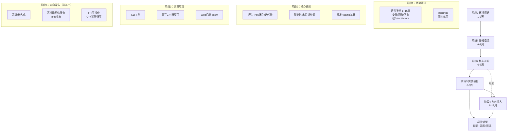

# Rust 学习路线图（C++ 背景纯小白定制版）

> 预计总时长：**6~9 个月**（在职业余学习，每天 1~2 小时；全职可压缩到 3~4 个月）
> 你的优势：C++ 背景意味着指针、栈/堆、RAII、模板这些概念不用重学，Rust 最难的"所有权"对你来说只是"把 C++ 的最佳实践变成编译器强制"。

## 一、总览路线图

## 二、分阶段详细计划

### 阶段 0：环境搭建（1~2 天）

- [ ] 安装 [rustup](https://rustup.rs)（Windows 选 MSVC 工具链），确认 `cargo --version` 可用
- [ ] VSCode + **rust-analyzer** 插件（必装，相当于 C++ 的 clangd）
- [ ] 可选：`cargo install cargo-expand`（宏展开）、`cargo clippy`（lint，自带的更严格编译器）
- [ ] 跑通第一个程序：`cargo new hello && cargo run`
- 熟悉 cargo 三件套：`cargo build` / `cargo run` / `cargo test`——比 CMake + vcpkg + conan 舒服得多

### 阶段 1：基础语法（6~8 周）——最难的坎在这里

**主教材**：`books/01-rust语言圣经-rust-course/`（在线版 [course.rs](https://course.rs)）第 1~15 章左右
**辅助**：卡壳时查 `books/02-rust程序设计语言-中文版/`（官方书中文版）对应章节
**练习**：每学完一个主题，做 `books/05-rustlings-官方练习/` 对应组

| 周 | 内容 | 语言圣经章节 | rustlings 组 | C++ 对照 |
| --- | --- | --- | --- | --- |
| 1 | 变量、标量/复合类型、函数、注释 | 2~3 章 | intro, variables, functions | `const`/`auto`/函数默认无特殊 |
| 2 | **所有权、移动、借用** ⭐ | 4 章 | move_semantics | `unique_ptr` 移动、悬垂引用——但 Rust 编译期强制 |
| 3 | struct、enum | 5~6 章 | structs, enums | `struct` 没有 public/private 分区、`std::variant` 的强化版 |
| 4 | **模式匹配** match/if let | 6 章 | enums, option | 没有 switch fallthrough，更强更安全 |
| 5 | 常用集合 Vec/HashMap、错误处理 Option/Result | 8~9 章 | option, result, vec, hashmaps | `std::optional`/异常的替代方案 |
| 6 | 泛型、Trait 基础 | 10 章 | traits, generics | 模板 + 概念 + 接口的混合体（鸭子类型静态化） |
| 7 | 生命周期入门 ⭐ | 讲义深入生命周期章节 | lifetimes | 引用有效期显式化——C++ 里靠人肉保证的东西 |
| 8 | 复习 + 综合练习 | — | 全部重做错的 | — |

> ⭐ 标记的是 Rust 三大坎：**所有权、借用、生命周期**。C++ 程序员在这里反而容易"过度自信"——语法像 C++，心智模型却不同。建议：每个编译错误都认真读，Rust 编译器的报错教育质量是所有语言里最高的。

### 阶段 2：核心进阶（6~8 周）

**主教材**：语言圣经后半部分 + `books/10-rust-by-example-官方示例/` 按主题查阅

| 周 | 内容 | 要点 |
| --- | --- | --- |
| 9~10 | 闭包、迭代器 | `Fn/FnMut/FnOnce` 三种 trait；迭代器是零成本抽象，替代手写循环 |
| 10 | 智能指针 Box/Rc/Arc/RefCell/Mutex | 对照 C++：`Box`=`unique_ptr`，`Rc`=`shared_ptr`，`RefCell`=运行期检查的可变借用 |
| 11 | 模块系统、包管理、工程组织 | workspace、features、crate 发布 |
| 12 | **测试**：单元/集成/doc test | Rust 的文档测试（doc-test）是杀手锏 |
| 13 | **并发**：线程、channel、Mutex、Send/Sync | 这是 C++ 背景最能看出差距的地方——数据竞争直接编译不过 |
| 14~15 | **异步** async/await、Future、tokio 入门 | 用 `books/11-async-book-异步编程/`（官方异步书）；先理解再到 tokio |

**刷题巩固**（与上面并行）：
- `books/06-rust-by-practice-实战练习/`：中文题库，每个知识点一组题
- `books/07-100-exercises-to-learn-rust/`：100 道渐进式练习，配讲解，适合从头刷到尾

### 阶段 3：实战项目（6~8 周，求职简历的来源）

按难度递进做 2~3 个，**代码放 GitHub**：

1. **CLI 工具**（1~2 周）：用 `clap` 写一个实用工具，比如：批量重命名、日志分析器、你平时用 C++ 写的小工具的 Rust 版
2. **重写一个自己熟悉的 C++ 项目**（2~3 周）⭐ 性价比最高：两边对比着写，体会安全性和表达力差异，面试还能讲出故事
3. **Web 后端**（2~3 周）：`axum` + `sqlx` + `tokio`，写一个 REST API（可以配合本 Python 项目里的业务逻辑做一个 Rust 版接口）
4. 加分项：给开源项目提一个小 PR（rustls、tokio、ripgrep 这类仓库的 good first issue）

### 阶段 4：方向深入（8~12 周，选其一）

| 方向 | 必读 | 说明 |
| --- | --- | --- |
| **系统/嵌入式** | 语言圣经 no_std 相关 + `books/14-rustonomicon-unsafe进阶/` | Rust 在嵌入式领域正在替代 C，C++ 背景直接迁移 |
| **高性能网络服务** | tokio 生态 + `books/11-async-book-异步编程/` | 国内 Rust 岗位的大头（区块链、数据库、中间件） |
| **并发/底层优化** | `books/13-rust-atomics-and-locks-en/`（并发圣经） | 内存序、锁实现——C++ `std::atomic` 经验直接复用 |
| **FFI/C++ 互操作** | cxx、bindgen 生态 | **C++ 背景独有优势**：大量存量 C++ 系统需要 Rust 渐进式改造，"懂 C++ 又懂 Rust"是这个赛道最稀缺的画像 |

## 三、C++ → Rust 概念速查表

| C++ | Rust | 差异要点 |
| --- | --- | --- |
| `new`/`delete` | `Box::new` / 自动 drop | 无手动 delete，RAII 全覆盖 |
| `unique_ptr` | `Box` / `move` 语义 | 默认移动，`Copy` 类型才拷贝 |
| `shared_ptr` | `Rc`（单线程）/ `Arc`（多线程） | 引用计数在编译期区分线程安全性 |
| 裸指针 + 人肉保证 | `&`/`&mut` + 借用检查器 | 编译期排除数据竞争和悬垂引用 |
| 模板 + concepts | 泛型 + trait bound | 单态化，报错可读 |
| 虚函数/继承 | trait + 动态分发 `dyn Trait` | 无类继承，组合优于继承被语言强制 |
| `std::variant` + `std::visit` | `enum` + `match` | 模式匹配是一等公民，穷尽性检查 |
| 异常 | `Result<T, E>` + `?` | 无异常，错误是返回值 |
| STL 算法/迭代器 | 迭代器适配器 | `map/filter/fold` 链式，零成本抽象 |
| `std::thread` + `mutex` | `std::thread` + `Mutex` | 所有权让锁保护数据的正确性可编译验证 |
| CMake | Cargo | 依赖、构建、测试、文档一体化，无 CMake 之痛 |
| 未定义行为（运行期爆炸） | 大量 UB 编译期拒绝 | 代价是学习曲线陡 + 有时要和借用检查器"搏斗" |

## 四、给 C++ 程序员的特别提醒（避坑）

1. **别用 C++ 的直觉猜语法**。Rust 看着像 C++，但默认不可变（`let` 不可变、`let mut` 才可变）、默认移动、无隐式转换——前期多看编译器说什么，少猜。
2. **和借用检查器的搏斗是正常的**。前期大量时间花在解决 `cannot borrow as mutable` 上不是你菜，每个人都这样。通常解法：缩小借用作用域、克隆（先能跑再优化）、重构数据所有权。
3. **不要过早深入 unsafe**。绝大多数应用开发用不到 unsafe；等阶段 4 再看 Rustonomicon。
4. **`clone()` 不丢人**。学习期先 `clone()` 跑通，再学着消除。过早追求零拷贝会让你卡死在生命周期上。
5. **用 `clippy` 当导师**。`cargo clippy` 的警告几乎每条都在教你地道写法。
6. **不要跳过练习只看书**。Rust 的知识必须过手，rustlings 做两遍比圣经读两遍有效。

## 五、每周时间预算参考

| 强度 | 每天 | 阶段1 | 全程 |
| --- | --- | --- | --- |
| 在职轻松 | 1h | 8 周 | 9 个月 |
| 在职认真 | 2h | 6 周 | 6 个月 |
| 全职冲刺 | 5h | 4 周 | 3~4 个月 |
